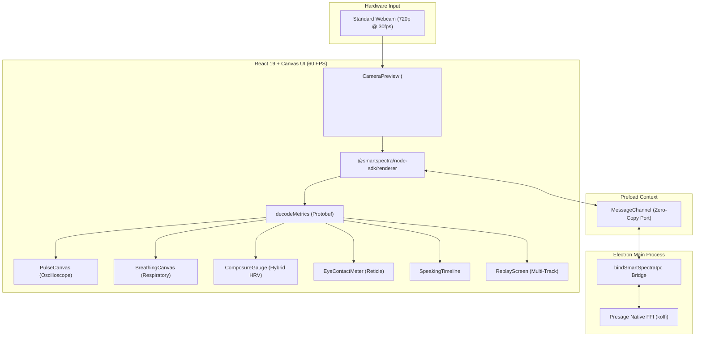

# 🎯 PitchPulse
### Contactless Biometric Presentation & Mock Interview Coach
*Powered by the **Presage SmartSpectra SDK***

[](https://opensource.org/licenses/Apache-2.0)
[](https://dev.to/challenges/presage-2026-11-04)
[](https://www.electronjs.org/)

---

## 💡 What is PitchPulse?

**PitchPulse** turns any standard laptop camera into a professional, real-time **biometric presentation and mock interview coach**. 

Public speaking and high-stakes interviews are inherently physiological: when we get nervous, our heart rate spikes, breathing shallows or freezes, our gaze drops to glance at notes, and speech rushes without breathing pauses. 

Until now, measuring these states required wearable chest straps or invasive finger sensors. With **Presage SmartSpectra**, PitchPulse extracts **6 continuous biometric & behavioral signals contactlessly from regular video frames** at 30–60 FPS:
1. **Pulse Plethysmography (PPG)**: Real-time heart rate (BPM) & arterial pressure trace
2. **Heart Rate Variability (HRV / RMSSD)**: Autonomic nervous system composure & coherence
3. **Respiratory Waveforms**: Upper chest & lower abdominal movement traces + breath-holding detection
4. **Gaze & Iris Landmark Vectors**: Eye contact percentage with the camera/audience
5. **Speech & Talking Activity**: Real-time talking detection, filler silence & pacing ratio
6. **Facial Expression Dynamics**: Tension vs. confidence emotion probability distribution

When your pitch concludes, PitchPulse generates a **Multi-Track Flight Recorder Replay** synchronizing all 6 streams with an interactive scrubber, a composite performance grade (0–100), and actionable tips.

---

## 🏗️ Architecture

PitchPulse uses a zero-copy MessagePort bridge between Electron's Main Process (native C++ FFI via `koffi`) and the React Renderer, rendering high-frequency physiological waveforms on pure HTML5 `<canvas>` elements at 60 FPS without React reconciliation stutter.



---

## 🔬 Mathematical Scoring & Hybrid HRV Fallback

SmartSpectra's autonomic HRV metrics (RMSSD & SDNN) require a 60-second rolling window before statistical confidence reaches validation. To prevent 30-to-45-second practice pitches from failing or reporting `0%`, PitchPulse features a **two-phase hybrid composure engine**:

* **Phase 1 ($t < 60\text{s}$)**: Composure is computed dynamically via:
  $$\text{Composure} = 0.40 \times \text{PulseStability} + 0.30 \times \text{BreathingCadence} + 0.30 \times \text{FacialCalm}$$
* **Phase 2 ($t \ge 60\text{s}$)**: As HRV confidence is achieved, RMSSD is smoothly blended in, unlocking the **`✨ Deep HRV Lock Acquired`** badge.

### Weighted Composite Score Breakdown:
* **Audience Eye Contact (25%)**: Percentage of time iris landmarks remain aligned with the camera reticle.
* **Composure & Autonomic Balance (25%)**: Steady pulse equilibrium and autonomic HRV coherence.
* **Speaking Pace & Rhythm (20%)**: Target 60–80% speech ratio with strategic breathing pauses.
* **Breath Control (15%)**: Rhythm stability and detection of unconscious breath-holding.
* **Expression Dynamics (10%)**: Ratio of composed/warm expressions vs. strain/tension.
* **Blink Naturalness (5%)**: Flags freezing/staring ($<8/\text{min}$) or rapid fluttering ($>28/\text{min}$).

---

## 🛡️ Camera Consent & Data Handling

* **100% Local Frame Processing**: Video frames captured from `getUserMedia` are processed in memory by the local SmartSpectra native runtime. **No video frames or raw facial images are ever recorded to disk or transmitted across the internet.**
* **Local Telemetry Retention**: Only mathematical telemetry points (e.g., heart rate integers, timestamps) are stored locally in the application's local user data directory (`pitchpulse_sessions/`) for session review. Users can delete any session at any time with one click.
* **Zero External Cloud AI**: PitchPulse does not forward biometric telemetry to third-party LLMs or cloud endpoints.
* **Non-Medical Wellness Scope**: PitchPulse is an educational practice tool for presentation training. It does not provide medical diagnosis, treatment, or clinical monitoring.

---

## 🚀 Getting Started

### Prerequisites
* **Node.js**: v20+ or v22+ LTS
* **npm**: v10+
* A front-facing webcam
* A **Presage SmartSpectra API Key** ([Register for free](https://physiology.presagetech.com/auth/register))

### Installation & Setup

1. **Clone the repository:**
   ```bash
   git clone https://github.com/JaniDhruv/PitchPulse.git
   cd PitchPulse
   ```

2. **Install dependencies:**
   ```bash
   npm install
   ```

3. **Configure your API Key:**
   Copy `.env.example` to `.env` and insert your SmartSpectra API key:
   ```bash
   cp .env.example .env
   ```
   *(Alternatively, you can paste your key directly into the in-app Consent & Settings screen upon launch).*

4. **Launch PitchPulse in Development Mode:**
   ```bash
   npm start
   ```

5. **Package for Distribution (Windows / Mac / Linux):**
   ```bash
   npm run make
   ```

---

## 📜 License

Distributed under the **Apache 2.0 License**. See [`LICENSE`](./LICENSE) for more information.

