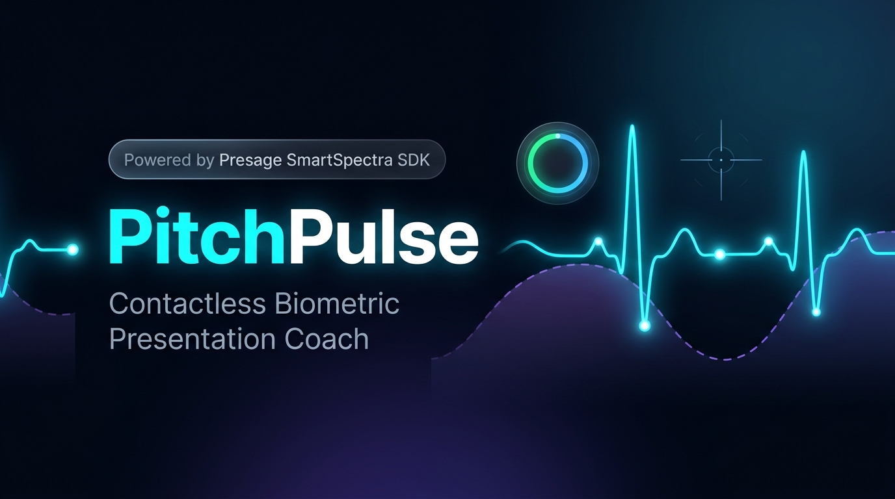
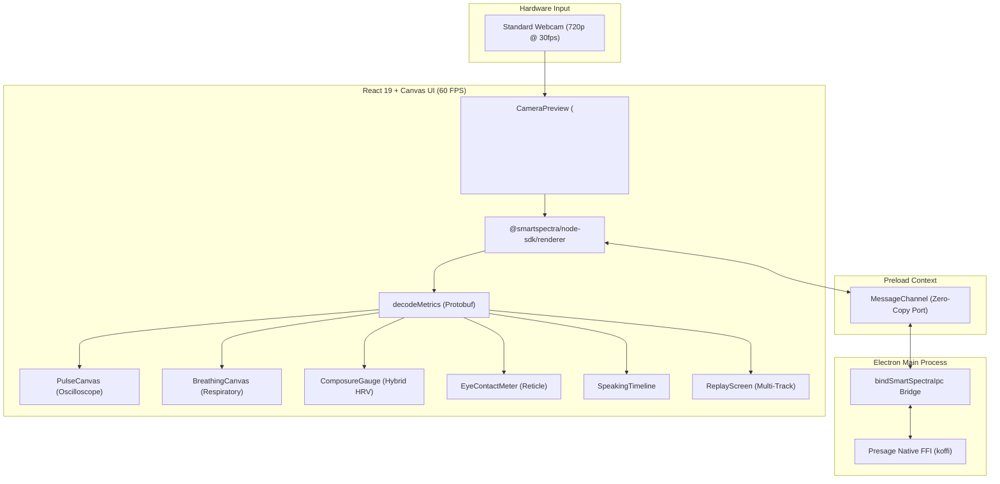

# 🎯 PitchPulse

### Contactless Biometric Presentation & Mock Interview Coach

\*Powered by the **Presage SmartSpectra SDK\***

[](https://opensource.org/licenses/Apache-2.0)
[](https://dev.to/challenges/presage-2026-11-04)
[](https://www.electronjs.org/)

<p align="center">
  
</p>

---

## 💡 What is PitchPulse?

**PitchPulse** turns any standard laptop camera into a professional, real-time **biometric presentation and mock interview coach**.

Public speaking and high-stakes interviews are inherently physiological: when we get nervous, our heart rate spikes, breathing shallows or freezes, our gaze drops to glance at notes, and speech rushes without breathing pauses.

Until now, measuring these states required wearable chest straps or invasive finger sensors. With **Presage SmartSpectra**, PitchPulse extracts **6 continuous biometric & behavioral signals contactlessly from regular video frames** at 30–60 FPS:

1. **Pulse Plethysmography (PPG)**: Real-time heart rate (BPM) & arterial pressure trace
2. **Heart Rate Variability (HRV / RMSSD)**: Autonomic nervous system composure & coherence
3. **Respiratory Waveforms**: Upper chest & lower abdominal movement traces + breath-holding detection
4. **Gaze & Iris Landmark Vectors**: Eye contact percentage with the camera/audience
5. **Speech & Talking Activity**: Real-time talking detection, filler silence & pacing ratio
6. **Facial Expression Dynamics**: Tension vs. confidence emotion probability distribution

When your pitch concludes, PitchPulse generates a **Multi-Track Flight Recorder Replay** synchronizing all 6 streams with an interactive scrubber, a composite performance grade (0–100), and actionable tips.

---

## 🏗️ Architecture

PitchPulse uses a zero-copy MessagePort bridge between Electron's Main Process (native C++ FFI via `koffi`) and the React Renderer, rendering high-frequency physiological waveforms on pure HTML5 `<canvas>` elements at 60 FPS without React reconciliation stutter.



---

## 🎬 The 45–60 Second Judge Walkthrough Story

PitchPulse is built around a single, undeniable human story that any judge can understand with the sound turned off:

```
[Take 1: Raw Pressure]
Speaker freezes on opening slide / stumbles on a tough Q&A question
  → Hits [⚡ Mark Pressure Moment] (Spacebar)
  → PitchPulse tracks the autonomic surge (+16 BPM spike, gaze drops to 45%)
  → Takes 24 seconds to recover composure!

[Autonomic Reset]
Speaker uses the Pre-Pitch Box Breathing Pacer (14s cycles) to reset baseline tone.

[Take 2: Ghost Take Rehearsal]
Speaker re-pitches with Take 1's cardiac trace as a violet ghost curve behind their live pulse wave
  → Encounters the same hard slide, maintains nasal breathing & lens focus
  → Hits [⚡ Mark Pressure Moment]
  → Heart rate barely spikes (+6 BPM) and returns to baseline in just 9 seconds!

[The Measurable Outcome]
🏆 "15 Seconds Faster Recovery After Pressure Moment!"
Not a vague, subjective AI score — an unmistakable, scientifically grounded physiological triumph.
```

---

## 🔬 Truth-to-Demo & Sensing Transparency

A presentation coach's greatest asset is scientific honesty. PitchPulse never masks simulated data as live hardware sensing:

- **● Live SmartSpectra SDK Mode**: When a valid SmartSpectra API key is present, the app initializes the native C++ FFI pipeline via `koffi` and `@smartspectra/node-sdk`. The UI displays an emerald badge `[● LIVE SMARTSPECTRA SDK]` with real-time signal confidence ratings (e.g. `Quality: 88%`) and baseline lock indicators.
- **⏳ Baseline Calibration Window**: During the first 15–20 seconds of optical rPPG video acquisition, PitchPulse displays an active countdown `[⏳ CALIBRATING BASELINE (14s/20s)]` to respect the optical blood absorption settling period.
- **⚠️ Transparent Demo Simulation Mode**: If no API key is provided or if network authentication fails, PitchPulse activates a dynamic biological simulation engine. The UI hard-labels the mode with prominent amber badges: `[⚠️ DEMO DATA — NO LIVE SENSING]`. All demo flight logs are explicitly tagged `[DEMO DATA - SIMULATED]` in Replay and History to guarantee absolute integrity.

---

## ⚡ Flagship Features

### 1. "Ghost Take": Did Your Recovery After the Hard Part Improve?

PitchPulse makes **Ghost Take** and **Pressure Moment Recovery** the focal point of speech training:

- **⚡ Instant Pressure Moment Marking (Spacebar / HUD Button):** During practice, the speaker marks their pressure moments (slide transitions, complex objections).
- **⏱️ Physiological Recovery Latency:** PitchPulse measures how many seconds it takes for heart rate to return to within 4 BPM of the pre-moment baseline, alongside gaze retention and breath stability during the critical 10-second post-stress window.
- **👻 Real-Time Ghost Wave Overlay:** During Ghost Take, Take 1's pulse wave appears as a translucent violet reference curve on the live 60 FPS oscilloscope.
- **🏆 Comparative Outcome Scorecard:** Replay highlights the exact second the pressure moment occurred, comparing Take 1 vs Ghost Take recovery latency side by side.

### 2. Streamlined 3-Signal Live Cockpit

During a live presentation, dense telemetry walls distract the speaker. PitchPulse narrows the live cockpit to **three readable, actionable signals**:

1. **Pulse & Autonomic Recovery:** Live heart rate (BPM), 60 FPS plethysmogram waveform, resting baseline, and real-time recovery timer.
2. **Audience Gaze Focus:** High-precision iris landmark reticle with centered/drifting feedback and gaze lock %.
3. **Breath Pacing & Rhythm:** Respiratory wave, breaths/minute, inhale/exhale rhythm cues, and talking-gated stabilization.

_Detailed post-flight analytics (speech pause counts, talk ratio timeline, emotion distributions) are moved to the Replay Flight Recorder where they belong._

### 2. Live Contextual Coaching Overlays

Instead of a passive telemetry recorder, PitchPulse acts as an active, supportive stage presence coach. When biometric sensors detect elevated sympathetic arousal, real-time coaching nudges softly appear directly over the speaker's camera feed:

- `💨 Breathe deeply… inhale through your nose` (triggered during prolonged breath-holds)
- `👀 Look at the camera — connect with your audience` (triggered when gaze drifts from lens)
- `🫀 Elevated cadence — pause 1 second and ground your feet` (triggered upon sudden heart rate spikes)
- `😌 Soften your jaw and brow — let warm confidence show` (triggered upon facial tension markers)
- `✨ Terrific composure and gaze lock! Maintain this rhythm` (positive reinforcement toasts)

### 3. Pre-Pitch Zen Breathing Pacer & Calibration

Addresses the SmartSpectra 60-second HRV warm-up requirement elegantly: before launching into a pitch, an expanding/contracting box-breathing orb guides the user through two deep breath cycles. This grounds stage nervousness, displays real-time pulse settling, and establishes a clean resting baseline before recording begins.

### 4. Cinematic Score Reveal & Interactive Recharts Replay

Upon completing a pitch, speakers experience an electrifying cinematic score reveal with animated radial gauge fill, grade badge drop, and instant 3-pillar breakdown. The full replay screen features synchronized multi-channel Recharts waveforms (pulse, breathing, gaze), peak stress spike navigation, and 1-click JSON flight log telemetry exports.

---

## 🔬 Model-Card Compliance & Scientific Rigor

- **Talking-Gated Breathing:** Optical rPPG respiratory estimations are confounded by jaw and torso movements while speaking. PitchPulse strictly respects SmartSpectra's model card guidelines by automatically gating respiratory calculations when `isSpeaking === true`, displaying `[🎙️ Speech Gated]` and locking the baseline trace rather than plotting motion noise.
- **HRV Warm-up Fallback:** Autonomic RMSSD & SDNN require 60 seconds before statistical confidence is reached. PitchPulse implements a two-phase hybrid composure fallback:
  $$\text{Live Composure} = 0.40 \times \text{PulseStability} + 0.30 \times \text{BreathStability} + 0.30 \times \text{FacialCalm}$$
  Once $t \ge 60\text{s}$ and confidence is confirmed, RMSSD is smoothly integrated into the Composure score with a `✨ Deep HRV Lock Acquired` badge.

---

## 🛡️ Camera Consent & Data Handling

- **100% Local Frame Processing**: Video frames captured from `getUserMedia` are processed in memory by the local SmartSpectra native runtime. **No video frames or raw facial images are ever recorded to disk or transmitted across the internet.**
- **Zero-Egress SDK Telemetry Toggle**: PitchPulse includes an explicit in-app toggle in the Consent Screen for `enableTelemetry`. When disabled (default), the SDK runtime runs with `enableTelemetry: false`, ensuring zero diagnostics or telemetry ever leave your machine.
- **Local Telemetry Retention**: Only mathematical telemetry points (e.g., heart rate integers, timestamps) are stored locally in the application's local user data directory (`pitchpulse_sessions/`) for session review. Users can delete any session at any time with one click.
- **Zero External Cloud AI**: PitchPulse does not forward biometric telemetry to third-party LLMs or cloud endpoints.
- **Non-Medical Wellness Scope**: PitchPulse is an educational practice tool for presentation training. It does not provide medical diagnosis, treatment, or clinical monitoring.

---

## 🏆 DEV Challenge Prize Categories Entered

- **Best Thoughtful Real-World Use:** Presentation & interview anxiety affects over 75% of professionals and students. PitchPulse provides an on-device, private, contactless biometric biofeedback loop to build physiological composure and authentic stage presence.
- **Most Creative or Delightful Use:** The "Ghost Take" feature borrows the beloved racing ghost mechanic from games like Mario Kart and translates it into high-stakes presentation coaching, transforming abstract heart rate numbers into an intuitive visual challenge.

---

## 🚀 Getting Started

### Prerequisites

- **Node.js**: v20+ or v22+ LTS
- **npm**: v10+
- A front-facing webcam
- A **Presage SmartSpectra API Key** ([Register for free](https://physiology.presagetech.com/auth/register))

### Installation & Setup

1. **Clone the repository:**

   ```bash
   git clone https://github.com/JaniDhruv/PitchPulse.git
   cd PitchPulse
   ```

2. **Install dependencies:**

   ```bash
   npm install
   ```

3. **Configure your API Key:**
   Copy `.env.example` to `.env` and insert your SmartSpectra API key:

   ```bash
   cp .env.example .env
   ```

   _(Alternatively, you can paste your key directly into the in-app Consent & Settings screen upon launch)._

4. **Launch PitchPulse in Development Mode:**

   ```bash
   npm start
   ```

5. **Package for Distribution (Windows / Mac / Linux):**
   ```bash
   npm run make
   ```

---

## 📜 License

Distributed under the **Apache 2.0 License**. See [`LICENSE`](./LICENSE) for more information.
