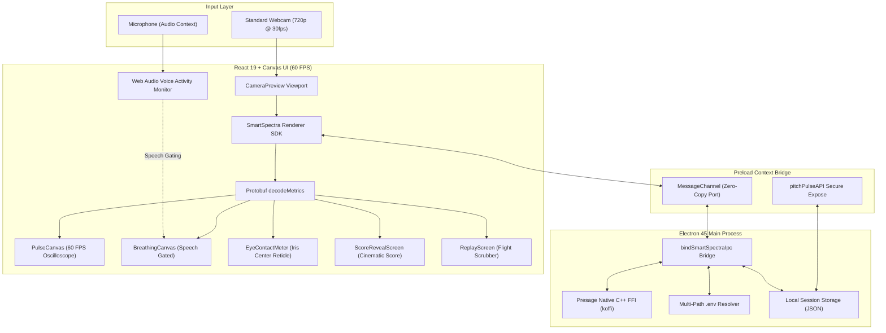

<p align="center">
  
</p>

<h1 align="center">🎯 PitchPulse</h1>

<h3 align="center">Contactless Autonomic Recovery Rehearsal for High-Pressure Speaking</h3>

<p align="center">
  <em>Practice the exact moment you freeze under pressure. Then prove you recover faster on the next take.</em>
</p>

<p align="center">
  Powered by <a href="https://smartspectra.presagetech.com/"><strong>Presage SmartSpectra SDK</strong></a> — Contactless Physiological Sensing via Standard Webcam
</p>

<p align="center">
  <a href="https://www.youtube.com/watch?v=-qHHrUmUZfs"></a>
  &nbsp;
  <a href="https://dev.to/challenges/presage-2026-11-04"></a>
  &nbsp;
  <a href="https://opensource.org/licenses/Apache-2.0"></a>
</p>

<p align="center">
  
  
  
  
  
  
  
  
</p>

---

## 📹 Video Walkthrough

Watch the complete unedited demonstration showing live **Presage SmartSpectra SDK** acquisition, real-time pressure marking, speech-gated respiratory stabilization, and the **Ghost Take** comparative recovery workflow:

<p align="center">
  <iframe width="720" height="405" src="https://www.youtube.com/embed/-qHHrUmUZfs" title="PitchPulse — Live Presage SmartSpectra SDK Walkthrough" frameborder="0" allow="accelerometer; autoplay; clipboard-write; encrypted-media; gyroscope; picture-in-picture; web-share" allowfullscreen style="border-radius: 12px; border: 1px solid rgba(255,255,255,0.15);"></iframe>
</p>

<p align="center">
  <a href="https://www.youtube.com/watch?v=-qHHrUmUZfs">
    
  </a>
</p>

<p align="center">
  <a href="https://www.youtube.com/watch?v=-qHHrUmUZfs"><strong>🔗 Direct Link: https://www.youtube.com/watch?v=-qHHrUmUZfs</strong></a>
</p>

> _"This isn't judging your confidence or diagnosing anxiety. It is helping speakers privately rehearse their own recovery pattern across repeated takes."_

---

## 💡 The Core Problem: Why Conventional Presentation Coaching Fails

Over **75% of people** suffer from speech anxiety (_glossophobia_). When preparing for an investor pitch, conference talk, or job interview, speakers don't fail continuously across 10 minutes — they stumble at **one specific pressure point**: the valuation slide, an aggressive objection, or a forgotten transition. Once adrenaline surges, peripheral blood vessels constrict, heart rate spikes, and composure unravels.

Conventional presentation coaches offer little help. They record your video, run an LLM, and output a vague, post-hoc verdict like _"74% Confidence Score."_ Telling a presenter they looked nervous 15 minutes after they stepped off stage has zero neuromuscular training value. Furthermore, Presage's own medical model cards rightly warn that optical rPPG sensors should **never** be used to deliver normative judgments on human confidence or diagnose emotion.

**PitchPulse** takes a fundamentally different, scientifically grounded approach: **Autonomic Recovery Rehearsal**.

Instead of grading how confident you "look," PitchPulse helps you rehearse your physiological recovery:

1. **Mark the Crisis Moment**: While rehearsing, tap `Spacebar` the exact second you tackle your toughest slide or question.
2. **Measure Recovery Latency**: PitchPulse anchors your pre-moment resting pulse and clocks the exact seconds until your heart rate returns to within $\pm 4\text{ BPM}$ of baseline.
3. **Ghost Take (Mario Kart for Your Nervous System)**: For Take 2, your first take’s recorded pulse timeline appears as a **translucent violet Ghost Curve** behind your live plethysmogram. You can literally watch your live pulse remain calm while your ghost curve spikes from last time.

> _"PitchPulse does not judge confidence or diagnose anxiety. It helps speakers privately measure and rehearse their own physiological recovery pattern across repeated takes."_

---

## 🚀 The Solution: Ghost Take Rehearsal Loop

PitchPulse transforms presentation practice into a **closed-loop recovery training ground**:

```
┌────────────────────────────────────────────────────────────────────────┐
│                              TAKE 1                                    │
│  Speaker tackles difficult opening or hostile objection.               │
│  Hits [⚡ Spacebar] at the hard moment.                                 │
│  SmartSpectra captures cardiac surge (e.g. 74 BPM → 92 BPM).            │
│  PitchPulse clocks exact Recovery Latency: 22s until baseline returns. │
└───────────────────────────────────┬────────────────────────────────────┘
                                    │
                         [Autonomic Reset Pacer]
                                    │
┌───────────────────────────────────▼────────────────────────────────────┐
│                       TAKE 2: GHOST TAKE MODE                          │
│  Speaker re-pitches against Take 1's actual recorded pulse timeline.   │
│  Translucent violet Ghost Wave replays right behind live pulse wave.   │
│  Speaker hits the same difficult objection with nasal pacing.          │
│  Live pulse remains grounded (e.g. 76 BPM) while Ghost Wave spikes!    │
│  Recovery Latency drops: 8s (14s faster recovery).                     │
└───────────────────────────────────┬────────────────────────────────────┘
                                    │
                         [Outcome Verification]
             🏆 Visual, Physical Proof of Measurable Composure
```

### The Mario Kart "Ghost Car" for Your Autonomic Nervous System 👻

In racing simulators, you don't improve by looking at a lap time sheet after the race; you race directly against a **translucent ghost of your previous lap**.

PitchPulse brings this mechanic to human physiology. During **Ghost Take**, Take 1's actual recorded pulse-rate samples are time-aligned and rendered as a violet ghost plethysmogram on the live 60 FPS oscilloscope. You can literally **see yourself out-performing your prior panic in real time**.

---

## ⚡ Flagship Capabilities

### 1. ⚡ Instant Pressure Moment Marking & Recovery Latency

- Tap `Spacebar` or the on-screen HUD button the exact second stress peaks (e.g., tough audience question or complex slide transition).
- PitchPulse anchors the timestamp, records baseline heart rate, and tracks **Recovery Latency**: the precise elapsed seconds until heart rate settles back to within $\pm 4\text{ BPM}$ of the pre-moment resting baseline.
- If no measurable pulse response occurs, PitchPulse explicitly displays _"No measurable pressure moment captured"_ — **it never manufactures artificial stress peaks or fake recovery numbers.**

### 2. 👻 High-Fidelity Ghost Take Overlay

- Take 2 dynamically streams Take 1's recorded `pulseSamples` as a time-aligned reference curve behind your live sensor wave.
- Synchronized across the entire session duration, providing instant feedback on whether your cardiac stability improved during the hardest portions of your talk.

### 3. 🎯 Streamlined 3-Signal Live Cockpit

During high-pressure speaking, dense walls of telemetry induce cognitive overload. PitchPulse isolates the live cockpit into **three essential, readable signals**:

1. **Pulse & Autonomic Recovery:** Real-time heart rate (BPM), 60 FPS plethysmogram wave, resting baseline indicator, and active recovery countdown.
2. **Audience Gaze Focus:** High-precision iris landmark reticle showing camera-facing gaze alignment and lock percentage.
3. **Breath Pacing & Rhythm:** Respiratory cycle wave, breaths per minute, inhale/exhale rhythm cues, and talking-gated stabilization.

### 4. 🎙️ Speech-Gated Respiratory Waveform

Optical rPPG respiratory estimations can be distorted by jaw, lip, and chest movements during vocalization. To preserve strict scientific integrity:

- PitchPulse uses the **Web Audio API** to monitor vocal bursts in real time.
- When speech is detected (`isSpeaking === true`), respiratory updates freeze and the canvas displays `[🎙️ Speech Gated]`.
- This prevents vocalization movement from being falsely plotted as breathing hyperventilation.

### 5. 💨 Pre-Pitch Box-Breathing Pacer

- An expanding/contracting Zen Pacer guides the speaker through a 14-second box-breathing cycle (Inhale 4s, Hold 4s, Exhale 4s, Hold 2s).
- Solves the physical optical rPPG warm-up requirement: grounds pre-pitch nerves, stabilizes resting heart rate, and locks an accurate baseline before recording begins.

### 6. 💬 Contextual Gentle Nudges

Soft, non-intrusive coaching cues surface directly over the camera feed only when sympathetic activation spikes:

- `💨 Breathe deeply… inhale through your nose` (detected during prolonged breath-holds)
- `👀 Look at the camera — connect with your audience` (detected upon gaze drift)
- `🫀 Elevated cadence — pause 1 second and ground your feet` (detected upon sudden pulse surge)
- `✨ Terrific composure and gaze lock! Maintain this rhythm` (positive reinforcement)

### 7. 🎬 Cinematic Score Reveal & Flight Recorder Replay

- An electrifying 6-second radial score reveal after finishing a take.
- Complete multi-track **Recharts** interactive flight recorder with scrubbable timelines for pulse, respiration, gaze, and speech bursts.
- Jump directly to marked pressure moments and export flight logs as raw JSON telemetry.

---

## 🛡️ Responsible Sensing Charter

Biometric sensing in professional environments requires absolute transparency, privacy, and scientific modesty. PitchPulse adheres to four non-negotiable principles:

| Principle                            | Technical Implementation                                                                                                                                                                                                                                                        |
| ------------------------------------ | ------------------------------------------------------------------------------------------------------------------------------------------------------------------------------------------------------------------------------------------------------------------------------- |
| **Self-Relative, Not Normative**     | We never compare speakers to an arbitrary "standard human" or claim a high heart rate makes someone a "bad presenter." All scores and recovery deltas are relative strictly to the speaker's own pre-pitch baseline.                                                            |
| **No Mind-Reading or Lie Detection** | Metrics are labeled with scientific humility (`Camera-Facing Gaze (Estimate)`, `Pulse Stability Index`). Facial tension is an optical muscle observation, not an emotion verdict.                                                                                               |
| **Zero Fabricated Outcomes**         | When no pressure moment or pulse response occurs, PitchPulse never invents a flattering statistic. It displays _"No measurable pressure moment captured"_ to uphold data integrity.                                                                                             |
| **Provenance Transparency**          | Live hardware runs display an emerald `[● Presage SmartSpectra SDK]` badge. Simulated sessions are hard-labeled with amber `[⚠️ DEMO DATA — NO LIVE SENSING]` banners. Ghost Take comparisons across modes feature an unmistakable `[Mixed Demo Comparison]` provenance tag.    |
| **100% Air-Gapped Local Privacy**    | Video frames from `getUserMedia` remain in volatile memory. **No video frames or raw facial images ever touch persistent storage or leave the device.** Telemetry stays in local memory and local user storage (`pitchpulse_sessions/`). Zero third-party cloud LLM forwarding. |
| **Telemetry Opt-Out**                | An explicit in-app toggle allows disabling all SDK diagnostic telemetry (`enableTelemetry: false`), guaranteeing zero network egress.                                                                                                                                           |

---

## 🏗️ System Architecture

PitchPulse uses a zero-copy `MessagePort` bridge between Electron's Main Process (native C++ FFI via `koffi`) and the React Renderer, rendering high-frequency physiological waveforms on pure HTML5 `<canvas>` elements at 60 FPS without React reconciliation stutter.



---

## 🔬 Model Card Compliance & Signal Math

### 1. Optical rPPG Settling Period

Optical blood absorption modeling requires an initial settling window to establish ambient chromatic normalization. PitchPulse respects this requirement by displaying an active countdown `[⏳ CALIBRATING BASELINE (14s/20s)]` before transitioning to live metric acquisition.

### 2. Speech-Gated Waveform Suppression

During speech, jaw displacement introduces motion artifacts into the upper respiratory trace buffer. When `isSpeaking === true`:
$$\text{BreathingRate}_{\text{active}} = \text{Hold}(\text{BreathingRate}_{t-1})$$
The live canvas draws a stabilized baseline rather than confounding vocal kinematics with pulmonary function.

### 3. Autonomic Composure Index (Hybrid 60s Warm-Up)

Full autonomic RMSSD & SDNN heart rate variability requires 60 seconds of continuous peak intervals to achieve statistical stability. PitchPulse deploys a two-phase hybrid composure calculation:

$$\text{Composure}_{t < 60\text{s}} = 0.40 \cdot \text{PulseStability} + 0.30 \cdot \text{BreathStability} + 0.30 \cdot \text{GazeStability}$$

Once $t \ge 60\text{s}$ and statistical confidence is achieved, raw rPPG HRV RMSSD is smoothly integrated into the Composure score with an active `✨ Deep HRV Lock Acquired` indicator.

---

## 🚀 Getting Started

### Prerequisites

- **Node.js**: `v20.x` or `v22.x` LTS
- **npm**: `v10.x` or higher
- Standard integrated webcam or USB camera (720p @ 30fps recommended)
- **Presage SmartSpectra API Key** — [Register for free trial](https://physiology.presagetech.com/auth/register)

### Quick Start in 4 Steps

```bash
# 1. Clone the repository
git clone https://github.com/JaniDhruv/PitchPulse.git
cd PitchPulse

# 2. Install dependencies
npm install

# 3. Configure your Presage SmartSpectra API Key
# PitchPulse dynamically resolves .env across both root and app directories:
cp .env.example .env
# Edit .env and paste your SMARTSPECTRA_API_KEY=your_key_here
# (Alternatively, you can paste it directly into the in-app Settings screen upon launch)

# 4. Launch PitchPulse in Development Mode
npm start
```

### Production Build / Package

```bash
# Package for distribution (Windows Squirrel installer / portable zip)
npm run make

# Run strict linter and formatting verification
npm run lint
```

---

## 🎮 Step-by-Step Practice Guide

```
[ Step 1: Consent & Key Setup ]
Launch app → Review privacy charter → Confirm local telemetry toggle → Proceed to Studio.

[ Step 2: Zen Calibration ]
Click [💨 Pacer] → Follow the 14-second expanding/contracting orb → Watch your resting pulse stabilize.

[ Step 3: Take 1 (The Pressure Run) ]
Click [Start Take 1: Mark a Pressure Moment] → Deliver your pitch → When you reach the hardest objection or slide, press Spacebar → Complete the talk.

[ Step 4: Inspect Recovery Latency ]
Enjoy the cinematic score reveal → Inspect Replay → Note your recovery latency seconds and pulse surge.

[ Step 5: Take 2 (Beat Your Ghost) ]
Click [Practice Again (Ghost Mode)] → Take 1's pulse appears as a violet ghost wave → Deliver the same section → Press Spacebar at the same milestone → Watch your live curve stay steady while the ghost spikes!
```

---

## 📁 Repository Structure

```
PitchPulse/
├── docs/
│   ├── cover.png                     # Hero application banner
│   └── cover.svg                     # Vector identity graphics
├── src/
│   ├── main.js                       # Electron main process + SmartSpectra IPC binding + .env resolver
│   ├── preload.js                    # Zero-copy MessagePort bridge + pitchPulseAPI contextBridge
│   └── renderer/
│       ├── App.jsx                   # Root application state & view orchestrator
│       ├── views/
│       │   ├── ConsentScreen.jsx     # Privacy charter, telemetry toggle & API key configuration
│       │   ├── SessionScreen.jsx     # Live 3-signal studio cockpit & hardware sensing lifecycle
│       │   ├── ScoreRevealScreen.jsx # 6-second cinematic score reveal animation
│       │   ├── ReplayScreen.jsx      # Synchronized multi-track flight recorder & ghost comparison
│       │   └── HistoryScreen.jsx     # Local session catalog with instant replay & deletion
│       ├── components/
│       │   ├── PulseCanvas.jsx       # 60 FPS plethysmogram canvas + violet Ghost Take overlay
│       │   ├── BreathingCanvas.jsx   # Speech-gated respiratory canvas waveform
│       │   ├── EyeContactMeter.jsx   # Iris gaze landmark reticle with alignment score
│       │   ├── CameraPreview.jsx     # Live webcam viewport + hardware status badges + HUD
│       │   ├── BreathingPacer.jsx    # Pre-pitch box-breathing calming orb
│       │   ├── CoachingOverlay.jsx   # Non-intrusive sympathetic arousal coaching toasts
│       │   ├── ComposureGauge.jsx    # Real-time circular hybrid composure indicator
│       │   └── SpeakingTimeline.jsx  # Vocalization timeline & cadence analysis
│       └── lib/
│           ├── constants.js          # Emotion palettes, consent policy, & thresholds
│           └── scoring.js            # Dynamic recovery latency & multi-pillar score algorithms
├── forge.config.mjs                  # Electron Forge build & packaging configuration
├── vite.main.config.mjs              # Vite configuration for Electron main process
├── vite.preload.config.mjs           # Vite configuration for secure preload bridge
├── vite.renderer.config.mjs          # Vite configuration for React 19 + Tailwind 4 frontend
├── package.json                      # Dependency manifests & lifecycle scripts
└── README.md                         # Authoritative project documentation & guide
```

---

## 🏆 Presage SmartSpectra SDK Challenge Alignment

| Category                            | Why PitchPulse Competes at the Highest Tier                                                                                                                                                                                                                                                                                                                               |
| ----------------------------------- | ------------------------------------------------------------------------------------------------------------------------------------------------------------------------------------------------------------------------------------------------------------------------------------------------------------------------------------------------------------------------- |
| **Best Thoughtful Real-World Use**  | Public speaking anxiety affects 75%+ of the global workforce. Instead of building another invasive "stress spy" or generic telemetry dial, PitchPulse provides a private, 100% on-device, self-relative tool that turns recovery into a repeatable rehearsal loop. Video never leaves the machine; telemetry defaults to zero egress; measurements honor medical modesty. |
| **Most Creative or Delightful Use** | Translates the beloved racing game "Ghost Car" mechanic into physiological self-mastery. Re-pitching against your own prior panic curve transforms abstract biometric numbers into an intuitive, empowering, and deeply satisfying skill-building game.                                                                                                                   |

---

## 📜 License & Credits

Distributed under the **Apache 2.0 License**. See [`LICENSE`](./LICENSE) for full details.

- **Developer:** Dhruv Jani ([@JaniDhruv](https://github.com/JaniDhruv))
- **Built for:** [Presage SmartSpectra SDK Challenge](https://dev.to/challenges/presage-2026-11-04)
- **SDK Provider:** [Presage Technologies](https://physiology.presagetech.com/)

---

<p align="center">
  <sub>Built with rigor and passion for the <strong>Presage SmartSpectra SDK Challenge</strong></sub>
</p>
